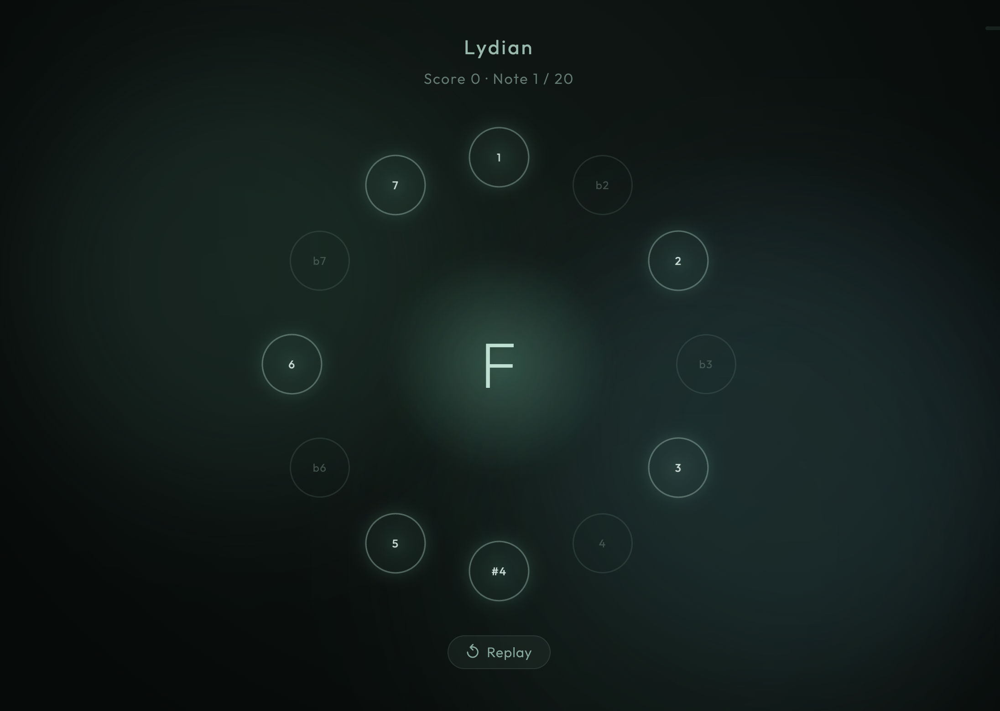

# Terval

A minimalist ear-training web game. Listen to a note played over a drone, then
click the matching interval on the chromatic wheel. Calm, contemplative, and
quick to play — reach 20 correct answers to master a level.



## Features

- **Two modes** — *Interval Training* (curated degree sets, grouped by minor /
  major / mixed) and *Scales & Modes* (practice the intervals of a chosen scale).
- **Chromatic wheel** — 12 interval positions; only the allowed ones light up.
- **Synthesized audio** — a warm handpan voice and a continuous drone built live
  with the Web Audio API, with reverb. No samples, no external assets.
- **Personal bests** — best score and mastery per level/scale, saved locally.
- **Zero runtime dependencies** — ~7 KB of JavaScript (gzipped).

## Tech stack

TypeScript · [Vite](https://vite.dev) · Web Audio API · DOM + CSS animations.
Tests run on [Vitest](https://vitest.dev).

## Getting started

Requires [Node.js](https://nodejs.org) (18+).

```bash
npm install     # install dependencies
npm run dev     # start the dev server at http://localhost:8080
npm run build   # production build into dist/
npm test        # run the unit tests
```

Audio starts on the first click (browser autoplay policy): press **Click to
start** to begin a round.

## Project structure

```text
src/
  music/        # pure music theory: notes, intervals, scales, pitch math
  audio/        # Web Audio: engine, handpan synth, drone
  game/
    core/       # GameController — the game loop as a framework-free state machine
    config/     # level definitions
    persistence/# score storage (LocalStorage, with in-memory fallback)
  ui/           # screens, the wheel, DOM helpers, styles
  main.ts       # entry point
```

The music logic is pure and framework-free; the audio engine is independent of
the game logic; the game core touches neither the DOM nor Web Audio. Everything
in `music/` and `game/` is unit-tested.

## Deployment

Pushing to `main` builds and deploys to GitHub Pages via
[`.github/workflows/deploy.yml`](.github/workflows/deploy.yml).

## License

MIT
